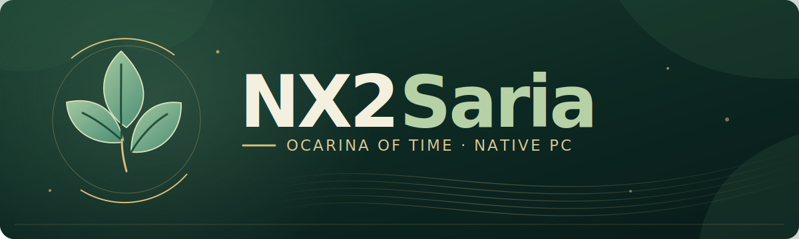

<h1 align="center">
  
</h1>

<p align="center">
  <strong>Ocarina of Time · Native PC recompilation</strong><br>
  Windows &amp; Linux · x86-64 · Vulkan
</p>

<p align="center">
  <a href="https://github.com/Larbaco/NX2Saria/releases">Releases</a> ·
  <a href="#getting-started">Getting started</a> ·
  <a href="docs/controls.md">Controls</a> ·
  <a href="docs/building.md">Build from source</a> ·
  <a href="CONTRIBUTING.md">Contributing</a>
</p>

**NX2Saria** is Larbaco's fork for bringing *The Legend of Zelda: Ocarina of Time* to a native PC application.
It statically recompiles the Nintendo Switch 2 edition, game version **1.1.1**, into x86-64 code and renders
through Vulkan. The game is built locally, from your own dump.

This fork brings together Linux work, changes to the settings menu and amiibo support, and selected community
fixes. It builds on NX2navi; see [Credits and origins](#credits-and-origins) for the project it comes from.

> [!IMPORTANT]
> **Bring your own game.** No game files are included. You need your own legally obtained copy, dumped from your
> own console. Instructions for obtaining those files are not provided. The finished build contains material
> from your game: keep it for your own use and do not distribute it.

## What makes this fork different

### A place for Linux

The build tools can produce a native Linux `ocarina`, alongside the Windows `ocarina.exe`. This fork adds
**FSR 3.1 upscaling through the runtime's own shader passes**, so Linux does not need AMD's Windows DLL for it.
The modes appear when the GPU and driver support the required shader features.

[Linux build and graphics setup →](docs/README-BuildKit.md#linux)

### Settings you apply when ready

Menu edits stay in a draft until you choose **Apply**. Settings that a game build does not support are hidden,
and **Ctrl+F5** reloads `nx2saria.ini` while the game runs. Monitor selection, fullscreen at startup and audio
output selection help fit the game into a desktop setup.

[Controls and menu guide →](docs/controls.md) · [All configuration keys →](nx2saria.ini.example)

### Amiibo within reach

When the game asks for an amiibo, a list of your own figure dumps can open over the game. The fork
keeps each figure's game data between sessions and offers optional encrypted write-back. A separate setting
lets you turn off the game's daily amiibo limit on version 1.1.1.

[Amiibo setup, saved data and write-back →](docs/amiibo.md)

The branch also integrates community fixes for AMD textures, shader-cache warming and contact shadows, plus
a controller-friendly frame-limit slider. Their authors remain credited in the commit history.

## The PC experience

- **Flexible frame rates.** 60 fps by default; choose a limit from 30 to 240, the display's refresh rate or unlimited.
- **Widescreen and ultrawide.** Window aspect, 21:9 or 32:9, with the HUD, menus and movies kept at 16:9.
- **Resolution and image quality.** From 1080p through 4K and beyond, with upscaling, anti-aliasing and HDR options.
- **Your controls.** Keyboard, mouse and gamepads, remapping, rumble and gyro; Nintendo, Xbox, PlayStation,
  Steam Deck and keyboard prompts where supported by the build.
- **In-game access.** **F1**, or **Minus + Plus** on a gamepad, opens settings; **F10** toggles the performance overlay.
- **Shader preparation.** Known shaders are prepared during the build, with pipeline warming at startup and
  background compilation. New shaders or driver changes can still cause pauses.

<details>
<summary><strong>Graphics options and platform differences</strong></summary>

- **Upscaling and anti-aliasing:** NVIDIA DLSS / DLAA on compatible RTX GPUs, AMD FSR 3.1, or FSR 1 and bilinear
  scaling. AMD FSR 4 is available on supported Radeon GPUs on Windows.
- **Frame generation:** NVIDIA DLSS on compatible RTX 40 / 50 GPUs. Linux requires the separate NVIDIA DLSS-G
  library and DLSS upscaling enabled at startup. AMD FSR 3.1 frame generation uses AMD's DLL on Windows; on Linux it
  runs through the game's own build of FSR 3.1's passes, on any GPU that runs them (tested on an AMD Radeon with
  RADV), at 2x and with SDR only. It works with any Upscaling choice.
- **HDR:** the game's native HDR or an enhanced tone-mapped picture, with display, game and HUD brightness
  controls. This fork also falls back to SDR for the run when Enhanced HDR cannot use an HDR10 display format.

Availability depends on the platform, GPU, driver and required libraries. The
[build kit guide](docs/README-BuildKit.md) covers setup; [the architecture guide](docs/architecture.md) describes
the renderer.

</details>

## Getting started

**Packages:** the [Releases page](https://github.com/Larbaco/NX2Saria/releases) has, from 0.12.1, a Windows setup
(`NX2Saria-Setup-<version>.exe`) and a Linux AppImage (`NX2Saria-Linux-<version>-x86_64.AppImage`). Both build the
game on your PC from your own dump; the notes of each release say how to install or update. To build from source
instead, use the guides below.

NX2Saria is the fork's name. Its settings file is `nx2saria.ini`, its environment variables start with `NX2SARIA_`,
and its release files start with `NX2Saria-`. Settings, saves and profiles from NX2navi keep working;
[names and compatibility](docs/branding.md) lists the older names.

### Before you build

- **Game:** your own `.nup` dump of the Nintendo Switch 2 edition with update **1.1.1**. The build kit checks the
  version before building; do not assume another update is compatible.
- **CPU and memory:** x86-64, SSE4.2, at least 16 GB of RAM. AVX2/FMA-capable CPUs can use a faster build.
  Memory-heavy areas can exceed what a 16 GB system has available.
- **Storage:** about 34 GB free for the game, in addition to the dump and build tools. The Windows launcher and
  its tools need about another 1.5 GB.
- **Graphics:** Vulkan 1.3 with `VK_EXT_external_memory_host` and `VK_EXT_mesh_shader`, and a current driver.
- **Platform:** Windows 10 or later, or Linux with kernel 6.7 or later. Linux also needs the compiler and
  development libraries listed in the build guide.

### Windows

Follow [Building from source](docs/building.md) to prepare the toolchain and source checkout, or
[the manual build kit guide](docs/README-BuildKit.md) if you already have a kit. The resulting game is
`ocarina.exe`. [The launcher guide](docs/launcher.md) explains the installer and update workflow for packaged
Windows builds.

### Linux

Follow [the Linux build kit guide](docs/README-BuildKit.md#linux) for dependencies and shader translator setup,
then run from the prepared checkout or kit:

```sh
python3 -I tools/make_game.py --nup "/path/to/your-game.nup" --out "$HOME/Games/Ocarina"
"$HOME/Games/Ocarina/ocarina"
```

On a 16 GB system, add `--jobs 4` to the build command to limit concurrent compiler processes. Linux support is
still in progress; see [the platform notes](docs/building.md#linux-in-progress) for requirements and limitations.

## Status and known issues

**In development.** The project has playable paths, but graphics, stability and performance vary by game version,
scene, hardware and driver. Inclusion of a community fix does not establish compatibility on every system.

- The first start after installation or a driver update, and the first visit to an area, can pause for compilation.
- A 16 GB system can run out of memory in Hyrule Field. Read the
  [memory and page file guidance](docs/README-BuildKit.md#playing) before playing on a constrained system.
- Some integrated AMD GPUs can fail at the title screen because of host memory heap limits.
- Visual bugs and crashes remain, including a rare crash in the game's particle code.
- Long Linux sessions and Steam Deck hardware validation remain open in the platform documentation.

Report bugs on the [issue tracker](https://github.com/Larbaco/NX2Saria/issues) and follow
[CONTRIBUTING.md](CONTRIBUTING.md): include the fork commit or package version, game update, OS, GPU and driver,
steps to reproduce, and the relevant log. Review attachments for private paths and never upload game files or keys.

## Documentation

- **Playing:** [controls](docs/controls.md), [settings reference](nx2saria.ini.example), [amiibo](docs/amiibo.md),
  [map trackers](docs/tracker-api.md).
- **Installing and building:** [build kit](docs/README-BuildKit.md), [source build](docs/building.md),
  [Windows launcher](docs/launcher.md).
- **Contributing:** [contribution guide](CONTRIBUTING.md), [architecture](docs/architecture.md),
  [Maxwell renderer notes](docs/maxwell.md).
- **Names:** [names and compatibility](docs/branding.md), including the older names that still work.

Build outputs stay in ignored `build/` and `generated/` folders. The runtime's shaders are kept as source;
compiled headers are generated during the build. Run `python tools/check_content.py` before committing.

## Credits and origins

NX2Saria is maintained by **[Larbaco](https://github.com/Larbaco)**. It is an independent fork of
**[NX2navi](https://github.com/tangerineturtle1/NX2navi)**, whose recompilation pipeline, runtime, renderer and
launcher form its foundation. Credit belongs to the original authors and to the community contributors whose
changes are integrated here; individual contributions and merge attributions remain in the commit history.

The NX2Saria name and README artwork identify this fork. They do not imply an official NX2navi release or a
Nintendo project. Some file and setting names keep the NX2navi spelling on purpose, for compatibility; [names and compatibility](docs/branding.md) lists them.

## License and notices

The source is public to read. Its additions and changes are all rights reserved
([LICENSE-ADDITIONS](LICENSE-ADDITIONS)): no part of them may be copied or published without written permission.
The base import stays under its [MIT License](LICENSE), and third-party code keeps its own license
([THIRD_PARTY_NOTICES.md](THIRD_PARTY_NOTICES.md)). No license grants anything for Nintendo's game.

NX2Saria is an independent, non-commercial fan project, not affiliated with or endorsed by Nintendo.
*The Legend of Zelda*, *Ocarina of Time* and *Nintendo Switch* are trademarks of Nintendo.
