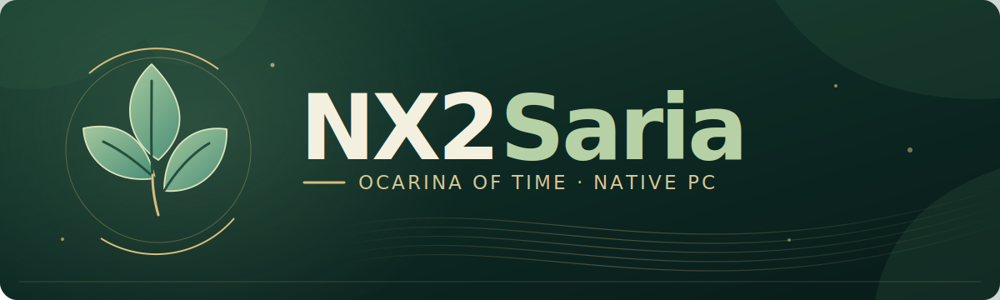

<!-- translation: lang=ru source=README.md source-hash=cdb66f910a3bd7945748728d03f3f678871d6980 reviewed=no -->
<h1 align="center">
  
</h1>

<p align="center">
  <strong>Ocarina of Time, перекомпилированная в нативную игру для ПК</strong><br>
  Windows и Linux · x86-64 · Vulkan
</p>

<p align="center">
  <a href="https://github.com/Larbaco/NX2Saria/releases/latest"></a>
</p>

<!-- languages -->
<p align="center"><a href="README.md">English</a> · <a href="README.pt-BR.md">Português (Brasil)</a> · <strong>Русский</strong> · <a href="README.zh-Hans.md">简体中文</a></p>

> Перевод [английской версии](README.md). Если они расходятся, действует английская версия.
>
> Этот перевод ещё не проверен носителем языка. Исправления приветствуются в [трекере задач](https://github.com/Larbaco/NX2Saria/issues).
<!-- /languages -->

<p align="center">
  <a href="docs/ru/install.md"><strong>Установка</strong></a> ·
  <a href="https://github.com/Larbaco/NX2Saria/releases">Выпуски</a> ·
  <a href="docs/ru/controls.md">Управление</a> ·
  <a href="docs/ru/known-issues.md">Известные проблемы</a> ·
  <a href="docs/building.md">Сборка из исходного кода</a> (на английском)
</p>

**NX2Saria** превращает *The Legend of Zelda: Ocarina of Time* для Nintendo Switch 2 (обновление игры **1.1.1**) в
нативную игру для Windows и Linux. Код игры статически перекомпилирован в x86-64, а изображение выводится через Vulkan:
никакой эмулятор под ней не работает.

Проект предназначен для игроков, у которых есть игра и которые могут сделать её дамп со своей консоли. **Чтобы начать,
скачайте установщик для Windows или AppImage для Linux из [последнего выпуска](https://github.com/Larbaco/NX2Saria/releases/latest)
и следуйте [руководству по установке](docs/ru/install.md).** Лаунчер собирает игру на вашем ПК из вашего дампа, а затем
поддерживает её в актуальном состоянии.

> [!IMPORTANT]
> **Игра нужна своя.** Файлы игры не входят в комплект. Вам нужна собственная законно приобретённая копия, дамп
> которой сделан с вашей консоли. Инструкции по получению этих файлов не предоставляются. Готовая сборка содержит
> материалы из вашей игры: используйте её только для себя и не распространяйте.

## Почему NX2Saria

- **Установите один раз, а обновления получайте в лаунчере.** Установщик и AppImage собирают игру из вашего дампа.
  Лаунчер предлагает каждый новый выпуск (*Stable* по умолчанию, *Preview* для предварительных выпусков) и оставляет
  на месте ваши сохранения, моды и настройки. [Установка и обновление →](docs/ru/install.md)
- **Linux с полной картинкой.** Апскейлинг AMD FSR 3.1 и генерация кадров FSR 3.1 работают через собственные
  шейдерные проходы игры, поэтому в Linux не нужна библиотека AMD, на любой видеокарте, драйвер Vulkan которой их
  выполняет. На RX 6700 (RADV), где это проверялось, генерация кадров стоила около 4 мс времени GPU на кадр при
  3440x1440. [Настройка в Linux →](docs/README-BuildKit.md#linux) (на английском)
- **Ультраширокий экран используется целиком.** При 21:9 и 32:9 меню паузы, карты и системы заполняют экран или, если
  вам так больше нравится, остаются посередине с чёрными полями по бокам. Интерфейс (HUD) может переносить сердца,
  предметы и мини-карту в углы экрана. [Интерфейс и меню на ультрашироком экране →](docs/wide-hud.md) (на английском)
- **Трекеры карты и предметов в реальном времени.** [Ocarina Atlas](docs/ocarina-atlas.md) (на английском) версии 2.3.0
  и новее следит за Линком на карте и отмечает собранные предметы по ходу игры; поддержка
  [hyrule-tracker](docs/hyrule-tracker.md) (на английском) находится в открытом pull request на его стороне. API
  трекеров работает только на чтение, доступен только с вашего ПК и выключен, пока вы не зададите `tracker_api = 1`.
  [API трекеров →](docs/tracker-api.md) (на английском)
- **Плавнее, пока шейдеры ещё готовятся.** После обновления игры или драйвера фоновая сборка конвейеров
  (pipeline) ждёт спокойных моментов (меню, загрузки), а не соперничает с игрой. В Лесу Кокири при 1280x720 с пустым
  кэшем драйвера средняя частота выросла примерно с 25 до 27–28 fps, а самый медленный 1 % кадров — с 64–70 мс до
  59 мс. Меньше вылетов и неправильной картинки, когда окно меняет размер или драйвер отказывается принять настройку.
  [Подробности →](docs/changelog/v0.15.0.md) (на английском)
- **Amiibo без хлопот.** Когда игра просит amiibo, поверх игры открывается список дампов ваших собственных фигурок.
  Каждая фигурка хранит свои данные, обратная запись необязательна, а дневной лимит можно отключить.
  [Руководство по amiibo →](docs/ru/amiibo.md)
- **Настройки применяются, когда вы готовы.** Изменения в меню сразу видны в предпросмотре и сохраняются, только когда
  вы выберете **Apply**. **Ctrl+F5** перечитывает `nx2saria.ini` прямо во время игры, а строки, которые эта версия
  игры не использует, скрыты.
- **Исправления сообщества в одном месте.** Исправления и ускорения от широкого сообщества, например исправления
  текстур для AMD, удержание видеопамяти в пределах бюджета и контактные тени, включены в проект, а их авторы указаны в
  [примечаниях к выпускам](docs/releases/) (на английском).
- **Сделано для тестирования.** `boot_map` запускает игру сразу в нужной области из сохранения, без титульного экрана
  ([загрузка сразу на карту](docs/boot-to-map.md) (на английском)); `tools/bench.py` измеряет сцены дважды одним и тем
  же способом ([производительность](docs/performance.md) (на английском)); последние изменения пишут в журнал игры, что
  они делают, поэтому по отчёту видно, включены ли они и работают ли.

## На любом ПК

- **Частота кадров:** 60 fps по умолчанию или ограничение от 30 до 240, частота обновления дисплея либо без ограничения.
- **Широкий экран:** по форме окна, 21:9 или 32:9. Видеоролики остаются в 16:9; интерфейс и меню тоже могут.
- **Качество изображения:** разрешения от 1080p до 4K и выше, апскейлинг, сглаживание, генерация кадров и HDR.
- **Управление:** клавиатура, мышь и геймпады, переназначение, вибрация и гироскоп.
- **В игре:** **F1** или **Minus + Plus** на геймпаде открывает настройки; **F10** показывает оверлей
  производительности. [Управление и меню →](docs/ru/controls.md) · [Все настройки →](nx2saria.ini.example) (на английском)

<details>
<summary><strong>Графические возможности по платформам</strong></summary>

- **Апскейлинг и сглаживание:** NVIDIA DLSS / DLAA на видеокартах RTX, AMD FSR 3.1 на любой видеокарте, которая его
  выполняет, AMD FSR 4 на поддерживаемых видеокартах Radeon в Windows либо FSR 1 и билинейное масштабирование.
- **Генерация кадров:** NVIDIA DLSS на видеокартах RTX 40 / 50 (в Linux нужны отдельная библиотека NVIDIA DLSS-G и
  апскейлинг DLSS, включённый при запуске). AMD FSR 3.1 использует библиотеку AMD в Windows; в Linux игра сама
  выполняет её проходы, только 2x и SDR, с любым вариантом апскейлинга.
- **HDR:** родной HDR игры или улучшенная картинка с тональным отображением, с регулировкой яркости дисплея, игры и
  интерфейса. Улучшенный HDR на время запуска переходит на SDR, если нужный ему формат дисплея недоступен.

Что именно доступно, зависит от платформы, видеокарты, драйвера и библиотек. [Руководство по набору для
сборки](docs/README-BuildKit.md) (на английском) описывает настройку; [руководство по архитектуре](docs/architecture.md)
(на английском) описывает рендерер.

</details>

## Начало работы

### Требования

- **Игра:** ваш собственный дамп `.nup` издания для Nintendo Switch 2 с обновлением **1.1.1**. Сборка проверяет
  версию; не рассчитывайте, что другое обновление совместимо.
- **Процессор и память:** x86-64 с SSE4.2, 16 ГБ ОЗУ или больше. При 16 ГБ перед игрой прочитайте
  [советы по памяти и файлу подкачки](docs/README-BuildKit.md#playing) (на английском).
- **Место на диске:** около 34 ГБ свободного места для игры, не считая дампа; лаунчер для Windows и его инструменты
  занимают ещё около 1,5 ГБ.
- **Графика:** Vulkan 1.3 с `VK_EXT_external_memory_host` и `VK_EXT_mesh_shader` и актуальный драйвер.
- **Система:** Windows 10 или новее либо Linux с ядром 6.7 или новее.

### Установка

В каждом [выпуске](https://github.com/Larbaco/NX2Saria/releases) есть `NX2Saria-Setup-<version>.exe` для Windows и
`NX2Saria-Linux-<version>-x86_64.AppImage` для Linux. В [руководстве по установке](docs/ru/install.md) описаны шаги, в
том числе то, как лаунчер, установленный из NX2navi, переходит на выпуски NX2Saria.

### Сборка из исходного кода

[Сборка из исходного кода](docs/building.md) (на английском) описывает настройку инструментов и рабочей копии;
[руководство по набору для сборки](docs/README-BuildKit.md) (на английском) собирает игру из подготовленного набора. В
Linux, после установки [пакетов](docs/README-BuildKit.md#linux) (на английском):

```sh
python3 -I tools/make_game.py --nup "/path/to/your-game.nup" --out "$HOME/Games/Ocarina"
"$HOME/Games/Ocarina/ocarina"
```

Сборка запускает каждую компиляцию, когда свободной памяти для неё достаточно, поэтому на ПК с небольшим объёмом ОЗУ
никакие параметры не нужны; `--jobs` и `--mem-limit` лишь ограничивают её сильнее
([контроль памяти при сборке](docs/build-memory.md), на английском).

## Состояние и известные проблемы

**В разработке.** В игру можно играть, но графика, стабильность и производительность всё ещё зависят от сцены,
оборудования и драйвера.

- Первый запуск после установки или обновления драйвера, а также первое посещение области могут прерываться паузами,
  пока собираются шейдеры и конвейеры.
- Системе с 16 ГБ может не хватить памяти в Поле Хайрула: см. [советы по памяти](docs/README-BuildKit.md#playing)
  (на английском).
- Некоторые встроенные видеокарты AMD могут давать сбой на титульном экране из-за ограничений кучи памяти хоста
  (host memory heap).
- Остаются визуальные ошибки и вылеты, включая редкий вылет в коде частиц игры. Долгие сеансы в Linux и устройство
  Steam Deck ещё проверяются ([заметки о Linux](docs/building.md#linux-in-progress) (на английском)).

В разделе [Известные проблемы](docs/ru/known-issues.md) перечислены открытые проблемы текущего выпуска и способы их
обойти.

**Нашли ошибку?** Создайте задачу (issue) в [трекере задач](https://github.com/Larbaco/NX2Saria/issues) и приложите
`logs\nx2saria.log` (`logs/nx2saria.log` в Linux) из папки игры. Укажите выпуск или коммит, ОС, видеокарту и драйвер,
которые вы используете, и как воспроизвести ошибку; полный список есть в [CONTRIBUTING.md](CONTRIBUTING.md) (на
английском). Проверьте вложения на личные пути и никогда не загружайте файлы игры или ключи.

Лаунчер также может отправлять короткий отчёт о том, как прошёл каждый сеанс, и комментарии без учётной записи
GitHub. Каждая новая версия спрашивает один раз при первом запуске; отчёты включаются, если вы не выберете
*Don't Send*, а в настройках их можно выключить и удалить отправленное. В
[отчётах о сеансах и комментариях](docs/ru/telemetry.md) точно сказано когда и перечислено каждое поле.

## Документация

| Тема | Руководства |
|---|---|
| Игра | [Установка и обновление](docs/ru/install.md) · [Управление](docs/ru/controls.md) · [Настройки](nx2saria.ini.example) (на английском) · [Amiibo](docs/ru/amiibo.md) · [Известные проблемы](docs/ru/known-issues.md) · [Отчёты о сеансах](docs/ru/telemetry.md) |
| Трекеры | [API трекеров](docs/tracker-api.md) (на английском) · [Ocarina Atlas](docs/ocarina-atlas.md) (на английском) · [hyrule-tracker](docs/hyrule-tracker.md) (на английском) |
| Выпуски | [Примечания к выпускам](docs/releases/) (на английском) · [Списки изменений](docs/changelog/) (на английском) |
| Сборка | [Набор для сборки](docs/README-BuildKit.md) (на английском) · [Из исходного кода](docs/building.md) (на английском) · [Лаунчер](docs/launcher.md) (на английском) |
| Тестирование | [Производительность](docs/performance.md) (на английском) · [Загрузка сразу на карту](docs/boot-to-map.md) (на английском) |
| Участие в разработке | [Руководство для участников](CONTRIBUTING.md) (на английском) · [Архитектура](docs/architecture.md) (на английском) · [Заметки о рендерере Maxwell](docs/maxwell.md) (на английском) |

**Имена.** Файл настроек называется `nx2saria.ini`, переменные окружения начинаются с `NX2SARIA_`, а файлы выпусков —
с `NX2Saria-`. Настройки, сохранения и профили из NX2navi продолжают работать; старые имена перечислены в разделе
[имена и совместимость](docs/branding.md) (на английском).

**Содержимое игры.** Результаты сборки остаются в игнорируемых папках `build/` и `generated/`, а шейдеры рантайма
хранятся в виде исходного кода. Перед коммитом запустите `python tools/check_content.py`.

## Авторы и происхождение

NX2Saria поддерживает **[Larbaco](https://github.com/Larbaco)** как независимый проект. Это форк
**[NX2navi](https://github.com/tangerineturtle1/NX2navi)**, чьи конвейер перекомпиляции, рантайм, рендерер и лаунчер
лежат в его основе: заслуга за них принадлежит авторам NX2navi. Изменения от участников сообщества указаны в
примечаниях к выпускам, и каждый вклад сохраняет своего автора в истории коммитов.

Спасибо [проекту Triforce](https://git.triforceproject.com/triforce/source) за его идеи: устройство его встроенной
генерации кадров повлияло на генерацию кадров FSR 3.1 в NX2Saria для Linux, а его идеи лежат в основе ожидания
спокойных моментов игры (play gate), метки кэша конвейеров и проверок вывода изображения. Его код здесь не
используется.

Название и оформление NX2Saria обозначают этот проект. Они не означают официальный выпуск NX2navi или проект
Nintendo. Некоторые имена файлов и настроек намеренно сохраняют написание NX2navi ради совместимости; они перечислены в
разделе [имена и совместимость](docs/branding.md) (на английском).

## Лицензия и уведомления

Исходный код открыт для чтения. Его дополнения и изменения защищены, все права сохранены
([LICENSE-ADDITIONS](LICENSE-ADDITIONS), на английском): никакую их часть нельзя копировать или публиковать без
письменного разрешения. Исходный импорт остаётся под своей [лицензией MIT](LICENSE) (на английском), а сторонний код
сохраняет собственную лицензию ([THIRD_PARTY_NOTICES.md](THIRD_PARTY_NOTICES.md), на английском). Никакая лицензия
не даёт никаких прав на игру Nintendo.

NX2Saria — независимый некоммерческий фанатский проект, не связанный с Nintendo и не одобренный ею.
*The Legend of Zelda*, *Ocarina of Time* и *Nintendo Switch* — товарные знаки Nintendo.

Этот раздел переведён для удобства: юридическую силу имеет английский текст README и файлов лицензий.
